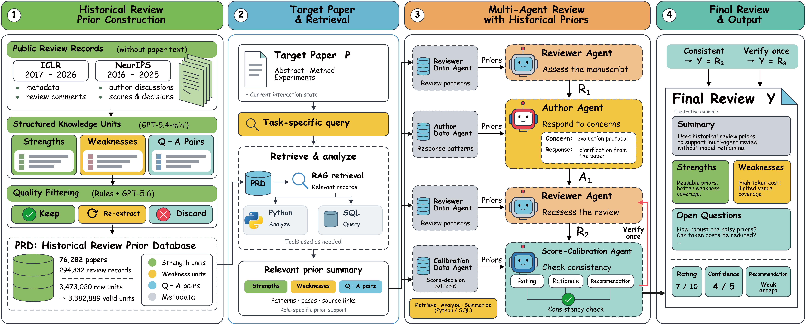

<div align="center">

# PriorReview

**A Multi-Agent Framework for Automated Peer Review<br>with Historical Review Priors**

<p>
  
  
  
</p>

[Overview](#overview) · [Dataset & Download](#dataset) · [Quick start](#quick-start) · [Results](#results) · [Configuration](docs/configuration.md)

</div>

<p align="center">
  <a href="assets/overview.pdf"></a>
</p>
<p align="center"><sub>Framework overview from the accompanying manuscript. <a href="assets/overview.pdf">View the vector PDF</a>.</sub></p>

## Overview

PriorReview uses historical peer-review experience to support a manuscript-grounded review process. A reviewer, an author-response agent, and a score-calibration agent collaborate with role-specific access to historical review priors, without retraining the backbone model.

- **Historical experience.** Retrieve relevant strengths, weaknesses, question–answer pairs, and score/decision patterns.
- **Staged review.** Produce an initial review, simulate an author reply, revise the review, and check score consistency.
- **Traceable outputs.** Save the final structured review, role outputs, discussion transcript, and tool traces for each run.
- **Autonomous data analysis.** Data specialists can write and run Python/SQL, inspect complete query results, debug scripts, and return evidence summaries. See [execution capabilities and configuration](docs/autonomous-data-agent.md).

The default workflow is:

```text
Manuscript → Initial review → Author response → Revised review
          → Score calibration → Optional reviewer verification → Final report
```

This repository provides the review agents and access to the **Peer-Review Prior Dataset (PRD)**. The dataset archives are distributed separately through the links below. Historical-data construction and experiment-analysis pipelines are outside this code release.

## Dataset

**Peer-Review Prior Dataset (PRD)** is the historical-prior resource used in the PriorReview study. It is constructed from publicly available **ICLR** and **NIPS/NeurIPS** review records, including paper metadata, review reports, author discussions, scores, and decisions. Manuscript text is excluded from the prior repository.

PRD organizes historical experience into **strengths**, **weaknesses**, and **reviewer-question / author-response pairs**, with source provenance. The manuscript reports the following corpus statistics after screening:

| Papers | Reviews | Retained knowledge units |
| ---: | ---: | ---: |
| **76,282** | **294,332** | **3,382,889** |

### Download

The archives are available through **Baidu Netdisk (百度网盘)**:

| Dataset | Download | Extraction code / 提取码 |
| :--- | :--- | :---: |
| NIPS / NeurIPS | [**NIPS.zip**](https://pan.baidu.com/s/1qYLNkpKuhIIfeDW5fVTvng?pwd=9p8k) | `9p8k` |
| ICLR | [**ICLR.zip**](https://pan.baidu.com/s/1STG-i2TqmOHdl2Trf4uQnQ?pwd=9p8k) | `9p8k` |

Download and extract the archives separately from the code. See [the historical-prior interface](docs/historical-priors.md) for connecting the released resources to the PostgreSQL/pgvector runtime. The code package does not include database construction or import scripts.

When using PRD, preserve its provenance and attribution fields and follow the terms of the original sources and any notices accompanying the archives. Paper citation details will be added when available.

## Quick start

Requires **Python 3.13+** and **uv**. Run the commands below from the repository root.

### 1. Install

```shell
uv sync --locked
```

### 2. Configure

Copy `.env.example` to `.env`:

```powershell
# Windows PowerShell
Copy-Item .env.example .env
```

```bash
# macOS / Linux
cp .env.example .env
```

Fill in the main-model and `FINALIZER_OPENAI_*` settings. To use historical priors, also configure an existing PostgreSQL/pgvector database and the embedding API. See [configuration](docs/configuration.md) and [the prior-store interface](docs/historical-priors.md).

### 3. Review a paper

The CLI accepts a **Markdown file** or a directory of Markdown papers. A small, explicitly synthetic input is provided for checking the input format:

```shell
# Check input discovery without making model or database calls.
uv run python main.py examples/sample_paper.md --dry-run

# Run a review after configuring the model and prior services.
uv run python main.py examples/sample_paper.md --output-dir outputs
```

For your own papers:

```shell
uv run python main.py path/to/paper.md --output-dir outputs
uv run python main.py path/to/papers --skip-existing --jobs 2 --output-dir outputs
```

Use `--limit 1` for a small first run and `--help` for all options. Convert PDFs to Markdown before invoking this CLI.

## Outputs

Each review has its own run directory:

```text
outputs/<paper_stem>/runs/<run_id>/
├── <paper_stem>.json         # Final structured review
├── run.json                 # Run status and metadata
├── transcript.md            # Review / response / calibration transcript
├── timeline.jsonl           # Event timeline
├── artifacts/
│   ├── inputs/              # Exact manuscript snapshot
│   ├── outputs/             # Role outputs and finalizer.md
│   └── data/                # Historical-prior queries and summaries
└── debug/                   # Prompt, model, and tool traces
```

The final report includes the summary, strengths, weaknesses, questions, rating, confidence, and recommendation. See the [illustrative JSON](examples/review_format.example.json) for the output structure; it is a hand-written format example, not a model result.

## Results

Selected results reported in the manuscript on its **80-paper test set**:

| Backbone with PriorReview | Overall F1 ↑ | Weakness F1 ↑ | Decision accuracy ↑ |
| :--- | ---: | ---: | ---: |
| GPT-5.4 | 0.687 | 0.653 | 0.725 |
| Claude Sonnet 4.6 | 0.715 | 0.677 | 0.688 |
| Gemini 3.1 Pro | 0.718 | 0.680 | 0.713 |

These are manuscript results, not measurements from the included example. Reproduction depends on the original model versions, prior database, test split, and evaluation protocol.

## Repository layout

```text
.
├── main.py                  # Single-paper and batch CLI
├── agent/
│   ├── core/                # Agents, prompts, settings, SQL/RAG, embeddings
│   ├── workflows/           # LangGraph orchestration
│   ├── schemas/             # Review and report data models
│   ├── logging/             # Run artifacts and traces
│   ├── tools/               # Optional external research tools
│   └── cli/                 # Standalone SQL/RAG query helpers
├── assets/                  # Manuscript framework figure
├── docs/                    # Configuration and prior-store interface
├── examples/                # Synthetic manuscript and output-format example
└── tests/                   # Unit tests and mocked workflow tests
```

Run the offline tests with:

```shell
uv run python -m unittest discover -s tests -v
```

## Paper and citation

**PriorReview: A Multi-Agent Framework for Automated Peer Review with Historical Review Priors.**

The public paper link, author list, and citation entry will be added when available.

## License

A code license has not yet been selected. No software license is granted by this preparation package. Historical-prior data and third-party dependencies have their own terms.
